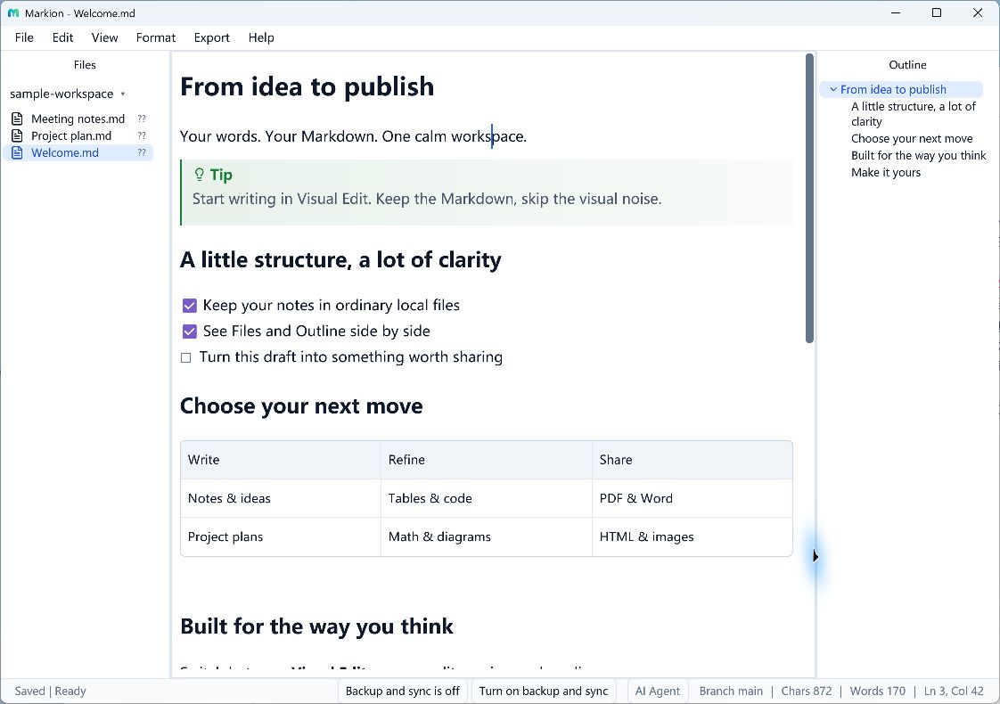

<p align="center"></p>
<h1 align="center">Markion</h1>
<p align="center"><strong>Natürlich schreiben. Markdown behalten.</strong><br>Ein nativer Editor für Notizen, technische Dokumente und deinen nächsten Artikel. Mit Rust + GPUI entwickelt.</p>

<p align="center"><a href="README.md">English</a> · <a href="README.zh-CN.md">简体中文</a> · <a href="README.zh-TW.md">繁體中文</a> · <a href="README.ja.md">日本語</a> · <a href="README.ko.md">한국어</a> · <a href="README.fr.md">Français</a> · <strong>Deutsch</strong> · <a href="README.es.md">Español</a></p>

<p align="center">
  <a href="https://github.com/willmove/markion/releases/latest"></a>
  
  <a href="LICENSE"></a>
</p>

<p align="center"><a href="#install"><strong>Herunterladen</strong></a> · <a href="#new-in-v061">Neuigkeiten</a> · <a href="#performance">Leistung</a> · <a href="docs/user-guide.md">Handbuch</a></p>



<p align="center"><sub>Echte Windows-Aufnahme, v0.6.0-Entwicklungsbuild · <a href="docs/images/README.md">Screenshots und Beispielordner</a></sub></p>

## Warum Markion

| ✍️ Ungehindert schreiben | 📁 Dateien selbst verwalten | 📤 Vom Entwurf zur Veröffentlichung |
| --- | --- | --- |
| Visuelles Bearbeiten blendet Syntax nach Bedarf aus. Quelltext und geteilte Vorschau sind jederzeit erreichbar. | Gewöhnliche lokale Markdown-Dateien, ohne Konto. Nativer Rust + GPUI-Editor ohne Electron oder eingebettete WebView. | Word importieren, Code, Formeln und Diagramme schreiben und als PDF, Word, HTML oder Bilder exportieren. |

<a id="new-in-v060"></a><a id="new-in-v061"></a>

## Neu in v0.6.1

| Highlights | Für deinen Schreiballtag |
| --- | --- |
| **Koreanische Oberfläche** | Acht vollständige UI-Sprachen; **한국어** in den Einstellungen wählen. |
| **Abstände nach Wunsch** | Zeilenabstand 75–300% und Absatzabstand 0–128px unter **Einstellungen → Erscheinungsbild**. |
| **Updates im Hintergrund vorbereiten** | Prüfung alle fünf Stunden, automatische Downloads standardmäßig aktiv. Installation nach Bestätigung; ungespeicherte Änderungen bleiben geschützt. |
| **Blöcke ohne Inhaltsverlust einfügen** | Kompaktes Einfügen-Menü und Tabelle/Trennlinie darunter hinzufügen erhalten vorhandene Inhalte; nach Trennlinien weiterschreiben. |

<p align="center"></p>
<p align="center"><sub>v0.6.0</sub></p>

[Versionshinweise](docs/release-notes/release-notes-v0.6.1.md) · [Projektstand und Prüfungen](docs/project-status.md)

<a id="install"></a>

## Herunterladen und losschreiben

| Plattform | Downloads für v0.6.3 |
| --- | --- |
| **Windows x64** | [Installationsprogramm](https://github.com/willmove/markion/releases/download/v0.6.3/markion_0.6.3_x64-setup.exe) · [Portables ZIP](https://github.com/willmove/markion/releases/download/v0.6.3/markion_0.6.3_x64-portable.zip) |
| **macOS 11+** | [Apple Silicon](https://github.com/willmove/markion/releases/download/v0.6.3/Markion_0.6.3_aarch64.dmg) · [Intel](https://github.com/willmove/markion/releases/download/v0.6.3/Markion_0.6.3_x64.dmg) |
| **Linux x86_64** | [AppImage](https://github.com/willmove/markion/releases/download/v0.6.3/markion_0.6.3_x86_64.AppImage) · [DEB](https://github.com/willmove/markion/releases/download/v0.6.3/markion_0.6.3_amd64.deb) · [RPM](https://github.com/willmove/markion/releases/download/v0.6.3/markion_0.6.3_x86_64.rpm) · [pacman (Arch/Omarchy)](https://github.com/willmove/markion/releases/download/v0.6.3/markion-0.6.3-1-x86_64.pkg.tar.zst) |

[Alle Versionen und Prüfinformationen](https://github.com/willmove/markion/releases)

- **Windows:** Installer ausführen oder ZIP entpacken. Noch keine Authenticode-Signatur; SmartScreen erfordert gegebenenfalls **Weitere Informationen → Trotzdem ausführen**.
- **macOS.** Öffnen Sie die passende DMG für Apple Silicon oder Intel, ziehen Sie Markion in „Programme“ und starten Sie es per Doppelklick. Beide DMGs sind mit Developer ID signiert und von Apple notarisiert. [Erster Start](docs/user-guide.md#install).
- **Linux:** AppImage ausführbar machen (`chmod +x markion*.AppImage`) und starten oder DEB/RPM/pacman installieren. Unter Arch Linux und Omarchy: `sudo pacman -U markion-0.6.3-1-x86_64.pkg.tar.zst`. Ohne FUSE: `--appimage-extract-and-run`.

Eine Markdown-Datei oder einen Ordner öffnen. Vor dem Bearbeiten der Beispiele **den gesamten examples-Ordner einschließlich Bildern kopieren**. [Einstieg und Vorlagen](assets/examples/README.md).

## Ein Dokument, vier Arbeitsweisen

| Modus | Geeignet für |
| --- | --- |
| **Visuelles Bearbeiten** · Standard | In gerendertem Markdown schreiben und Text, Tabellen, Code und Formeln direkt bearbeiten. |
| **Quelltext** | Die gesamte Markdown-Syntax kontrollieren. |
| **Geteilte Vorschau** | Quelltext und Vorschau nebeneinander, optional mit synchronem Scrollen. |
| **Lesen** | Eine ruhige Ansicht ohne Bearbeitung. |

Position, Auswahl und Rückgängig-Verlauf bleiben beim Wechsel erhalten. [Tastenkürzel](docs/keyboard-shortcuts.md).

| Vom Entwurf zur Ausgabe | Enthalten |
| --- | --- |
| **Technisches Schreiben** | GFM-Tabellen, Syntaxhervorhebung, LaTeX-Formeln, Mermaid, Fußnoten, Hinweisblöcke und navigierbare Gliederung. |
| **Vorhandene Inhalte übernehmen** | Lokaler DOCX-Import und formatiertes Einfügen aus Word, Google Docs oder dem Web. [Word-Import](docs/word-import.md) |
| **Export und Veröffentlichung** | Markdown, HTML mit/ohne Stil, LaTeX, DOCX, PDF, PNG/JPEG und lokaler MarkNice-Arbeitsbereich für WeChat. [Veröffentlichung](docs/marknice-workspace.md) |
| **Bilder und Ressourcen** | Einfügen, Ziehen, Kopieren/Herunterladen oder Hochladen über PicGo/eigene Befehle. [Bildanleitung](docs/image-handling.md) |
| **Individuell einrichten** | Themes, Schriftarten pro Oberfläche und Typografie unter **Einstellungen → Erscheinungsbild**; Fokus-/Schreibmaschinenmodus und eigene Tastenkürzel. |
| **Optionale Verbindungen** | Git-basierte Sicherung und Synchronisierung; AI Agent mit eigenem Schlüssel oder lokalen Modellen. KI ist **standardmäßig ausgeschaltet**. [Synchronisierung](docs/git-sync.md) · [KI](docs/ai-agent-guide.md) |

<a id="performance"></a>

## Nachprüfbare Leistung

**Historische Windows-Messung im Release-Build · 2026-11-11.** Intel Core Ultra 5 225U, ca. 31 GiB RAM; 100 lokale Änderungen pro Größe. Vergleich der **Modellverarbeitung**, ohne UI-Layout/paint und GPU-Darstellung.

| Gemischtes Markdown | Erster Modellaufbau | Bearbeitung P50 | Bearbeitung P95 |
| --- | ---: | ---: | ---: |
| 100 KiB | 10.77 ms | **0.64 ms** | 1.21 ms |
| 300 KiB | 28.67 ms | **2.55 ms** | 3.69 ms |
| 600 KiB | 55.03 ms | **5.81 ms** | 6.86 ms |
| 1 MiB | 96.84 ms | **10.33 ms** | 11.24 ms |

Bei einem separaten Lauf mit **1080 System-Tastenereignissen** in einem 1-MiB-Dokument betrug Eingabe-Callback → Cursor-paint **26.63 ms P50 / 33.14 ms P95**. Hardware-/OS-Übertragung und GPU-Darstellung sind ausgeschlossen. Dies sind frühere Ergebnisse, kein neuer v0.6.1-Benchmark oder Wettbewerbsranking. [Methode, Rohdaten und Reproduktion](docs/performance.md).

## Vor dem Start beachten

- Markdown bleibt die maßgebliche Quelle. Nicht unterstützte oder auf Byte-Ebene mehrdeutige Syntax nutzt konservative Quelltextbearbeitung. Keine verbundenen GFM-Zellen oder pixelgenauen Bildzuschnitte. [Abdeckung und Lücken](docs/visual-editing-quality.md).
- Integriertes PDF/DOCX benötigt keinen externen Konverter; optionales Pandoc fällt bei Fehlern auf den integrierten Export zurück. Die Wiedergabe unterscheidet sich je Format. Der MarkNice-Browserbereich folgt der Oberfläche seiner festgelegten Editorversion. Word-Import bleibt in der Sitzung und schreibt nicht nach Markion zurück; zur Übernahme **Copy MD** oder ausdrücklich Markdown speichern. Word und thematischer PDF-Druck im Browser unterscheiden sich vom nativen Export. Markdown-/PDF-/Bildimport und Beispielaktionen werden dort nicht angeboten.
- Windows-Installationen und Linux-AppImages unterstützen die Installation Minisign-geprüfter Updates in der App. macOS und DEB/RPM/pacman öffnen einen Download. Diese Prüfung ist von der OS-Codesignatur getrennt.
- **README und Oberfläche in 8 Sprachen**: Englisch, vereinfachtes/traditionelles Chinesisch, Japanisch, Koreanisch, Französisch, Deutsch und Spanisch. **한국어** in den Einstellungen wählen.

## Bauen und beitragen

Mit Rust stable und den nativen Build-Werkzeugen deiner Plattform ([CI-Konfiguration](.github/workflows/release.yml)) im Repository-Stamm ausführen:

```powershell
cargo run
cargo test --workspace
pwsh ./scripts/check-quality.ps1
```

[Handbuch / 使用指南](docs/user-guide.md) · [FAQ](docs/faq.md) · [Fehler melden](https://github.com/willmove/markion/issues) · [Release-Ablauf](docs/release-process.md) · [MIT-Lizenz](LICENSE)
