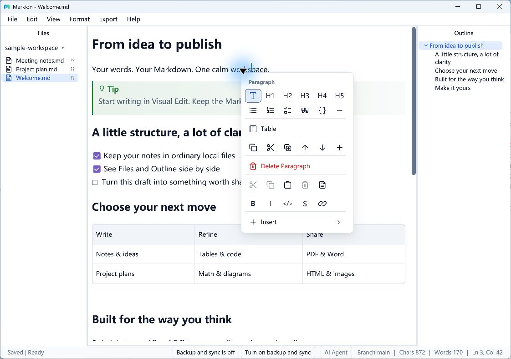

<p align="center"></p>
<h1 align="center">Markion</h1>
<p align="center"><strong>Écrivez naturellement. Gardez votre Markdown.</strong><br>Un éditeur natif pour vos notes, documents techniques et prochains articles. Conçu avec Rust + GPUI.</p>

<p align="center"><a href="README.md">English</a> · <a href="README.zh-CN.md">简体中文</a> · <a href="README.zh-TW.md">繁體中文</a> · <a href="README.ja.md">日本語</a> · <a href="README.ko.md">한국어</a> · <strong>Français</strong> · <a href="README.de.md">Deutsch</a> · <a href="README.es.md">Español</a></p>

<p align="center">
  <a href="https://github.com/willmove/markion/releases/latest"></a>
  
  <a href="LICENSE"></a>
</p>

<p align="center"><a href="#install"><strong>Télécharger</strong></a> · <a href="#new-in-v064">Nouveautés</a> · <a href="#performance">Performances</a> · <a href="docs/user-guide.md">Guide</a></p>


<p align="center"><sub>Capture réelle sous Windows, version de développement v0.6.0 · <a href="docs/images/README.md">Captures et espace de démonstration</a></sub></p>

## Pourquoi Markion

| ✍️ Écrire sans friction | 📁 Garder la maîtrise | 📤 Aller jusqu’à la publication |
| --- | --- | --- |
| L’édition visuelle masque la syntaxe selon les besoins. Passez à la source ou à l’aperçu partagé à tout moment. | De simples fichiers Markdown locaux, sans compte. Un éditeur natif Rust + GPUI, sans Electron ni WebView intégré. | Importez Word, rédigez du code, des formules et des diagrammes, puis exportez en PDF, Word, HTML ou images. |

<a id="new-in-v060"></a><a id="new-in-v061"></a><a id="new-in-v063"></a><a id="new-in-v064"></a>

## Nouveautés de la v0.6.4

| À découvrir | Pour votre écriture |
| --- | --- |
| **Le code s’ouvre déplié** | Le repli devient facultatif : activez **Autoriser le repli du code en édition visuelle** dans **Préférences → Apparence** (Blocs de code) pour retrouver la commande Replier le code / Déplier le code. |
| **Des tableaux mieux maîtrisés** | Le menu de poignée du tableau réunit les commandes de tableau entier, ajoute **Égaliser la largeur des colonnes** et propose sous Insérer en dessous le même catalogue que les paragraphes. Sélectionner du texte dans un grand tableau ne fait plus défiler la page. |
| **Affiché comme écrit** | Titres et images dans les citations, graisse des en-têtes et alignement des colonnes des tableaux, gras/italique imbriqués et ponctuation de fin qui reste avec son texte s’affichent correctement dans chaque mode. |
| **Import et export fidèles** | L’import Word conserve la numérotation des listes, les sauts de ligne manuels et la mise en forme explicite ; l’export LaTeX conserve l’imbrication des listes et leurs numéros de départ ; l’export Word garde entiers les liens stylés. |
| **Plus sûr par défaut** | Le mode Lecture ne modifie plus le document. Renommer un fichier ou un dossier est refusé tant qu’un onglet ouvert contient des modifications non enregistrées, et la restauration de session laisse intacte la liste Ouvrir récent. |

<p align="center"></p>
<p align="center"><sub>v0.6.0</sub></p>

[Notes de version](docs/release-notes/release-notes-v0.6.4.md) · [État du projet et vérifications](docs/project-status.md)

<a id="install"></a>

## Téléchargez et commencez à écrire

| Plateforme | Téléchargements v0.6.4 |
| --- | --- |
| **Windows x64** | [Installateur](https://github.com/willmove/markion/releases/download/v0.6.4/markion_0.6.4_x64-setup.exe) · [ZIP portable](https://github.com/willmove/markion/releases/download/v0.6.4/markion_0.6.4_x64-portable.zip) |
| **macOS 11+** | [Apple Silicon](https://github.com/willmove/markion/releases/download/v0.6.4/Markion_0.6.4_aarch64.dmg) · [Intel](https://github.com/willmove/markion/releases/download/v0.6.4/Markion_0.6.4_x64.dmg) |
| **Linux x86_64** | [AppImage](https://github.com/willmove/markion/releases/download/v0.6.4/markion_0.6.4_x86_64.AppImage) · [DEB](https://github.com/willmove/markion/releases/download/v0.6.4/markion_0.6.4_amd64.deb) · [RPM](https://github.com/willmove/markion/releases/download/v0.6.4/markion_0.6.4_x86_64.rpm) · [pacman (Arch/Omarchy)](https://github.com/willmove/markion/releases/download/v0.6.4/markion-0.6.4-1-x86_64.pkg.tar.zst) |

[Toutes les versions et vérifications](https://github.com/willmove/markion/releases)

- **Windows :** lancez l’installateur ou décompressez le ZIP. Pas encore de signature Authenticode ; SmartScreen peut demander **Informations complémentaires → Exécuter quand même**.
- **macOS.** Ouvrez le DMG Apple Silicon ou Intel adapté à votre Mac, glissez Markion dans Applications, puis double-cliquez dessus. Les deux DMG sont signés avec Developer ID et notarisés par Apple. [Premier lancement](docs/user-guide.md#install).
- **Linux :** rendez l’AppImage exécutable (`chmod +x markion*.AppImage`), puis lancez-la, ou installez le DEB/RPM/pacman. Sous Arch Linux et Omarchy, exécutez `sudo pacman -U markion-0.6.4-1-x86_64.pkg.tar.zst`. Sans FUSE, utilisez `--appimage-extract-and-run`.

Ouvrez un fichier ou dossier Markdown. Avant de modifier les exemples, **copiez tout le dossier examples, images comprises**. [Premiers pas et modèles](assets/examples/README.md).

## Un document, quatre façons de travailler

| Mode | Usage |
| --- | --- |
| **Édition visuelle** · par défaut | Écrivez dans le Markdown rendu et modifiez directement texte, tableaux, code et formules. |
| **Source** | Maîtrisez toute la syntaxe Markdown. |
| **Aperçu partagé** | Source et aperçu côte à côte, avec défilement synchronisé facultatif. |
| **Lecture** | Un affichage épuré, sans édition. |

Changez de mode en conservant position, sélection et historique d’annulation. [Raccourcis](docs/keyboard-shortcuts.md).

| Du brouillon au document final | Fonctions incluses |
| --- | --- |
| **Rédaction technique** | Tableaux GFM, coloration du code, formules LaTeX, Mermaid, notes de bas de page, encadrés et plan navigable. |
| **Reprendre un travail existant** | Import DOCX local et collage enrichi depuis Word, Google Docs ou le Web. [Import Word](docs/word-import.md) |
| **Exporter et publier** | Markdown, HTML avec/sans styles, LaTeX, DOCX, PDF, PNG/JPEG et espace MarkNice local pour WeChat. [Publication](docs/marknice-workspace.md) |
| **Images et ressources** | Collage, glisser-déposer, copie/téléchargement ou envoi via PicGo/commande personnalisée. [Images](docs/image-handling.md) |
| **À votre goût** | Thèmes, polices par surface et typographie dans **Préférences → Apparence** ; modes concentration/machine à écrire et raccourcis personnalisés. |
| **Connexions facultatives** | Sauvegarde et synchronisation via Git ; AI Agent avec votre clé ou des modèles locaux. L’IA est **désactivée par défaut**. [Synchronisation](docs/git-sync.md) · [IA](docs/ai-agent-guide.md) |

<a id="performance"></a>

## Des performances vérifiables

**Mesures historiques sous Windows, compilation release · 2026-11-11.** Intel Core Ultra 5 225U, ~31 GiB de RAM ; 100 modifications locales par taille. Comparaison du **traitement du modèle**, hors disposition/paint de l’interface et présentation GPU.

| Markdown mixte | Construction initiale | Édition P50 | Édition P95 |
| --- | ---: | ---: | ---: |
| 100 KiB | 10.77 ms | **0.64 ms** | 1.21 ms |
| 300 KiB | 28.67 ms | **2.55 ms** | 3.69 ms |
| 600 KiB | 55.03 ms | **5.81 ms** | 6.86 ms |
| 1 MiB | 96.84 ms | **10.33 ms** | 11.24 ms |

Lors d’un essai distinct de **1080 événements clavier système** sur 1 MiB, le délai rappel d’entrée de l’application → paint du curseur était de **26.63 ms P50 / 33.14 ms P95**. Le transport matériel/OS et la présentation GPU sont exclus. Ces résultats antérieurs ne sont ni un nouveau test de la v0.6.4 ni un classement des concurrents. [Méthode, données brutes et reproduction](docs/performance.md).

## À savoir avant de commencer

- Markdown reste la source de vérité. Les syntaxes non prises en charge ou ambiguës au niveau des octets utilisent une édition source prudente. Pas de cellules fusionnées GFM ni de recadrage d’image au pixel. [Couverture et limites](docs/visual-editing-quality.md).
- Les exports PDF/DOCX intégrés n’exigent aucun convertisseur externe ; Pandoc est facultatif, avec repli intégré en cas d’échec. La fidélité dépend du format. L’espace MarkNice dans le navigateur suit l’apparence de son éditeur épinglé. L’import Word reste dans la session, sans écriture dans Markion : utilisez **Copy MD** ou enregistrez explicitement le Markdown pour le récupérer. Ses exports Word et PDF par impression thémée diffèrent des exports natifs ; cet espace ne propose ni import Markdown/PDF/image ni actions sur des exemples.
- Les installations Windows et AppImage Linux permettent l’installation des mises à jour vérifiées par Minisign. macOS et DEB/RPM/pacman ouvrent un téléchargement. Cette vérification est distincte de la signature du système.
- **README et interface en 8 langues** : anglais, chinois simplifié/traditionnel, japonais, coréen, français, allemand et espagnol. Choisissez **한국어** dans les préférences.

## Compiler et contribuer

Avec Rust stable et les outils natifs de votre plateforme ([recettes CI](.github/workflows/release.yml)), depuis la racine du dépôt :

```powershell
cargo run
cargo test --workspace
pwsh ./scripts/check-quality.ps1
```

[Guide / 使用指南](docs/user-guide.md) · [FAQ](docs/faq.md) · [Signaler un problème](https://github.com/willmove/markion/issues) · [Publication des versions](docs/release-process.md) · [Licence MIT](LICENSE)
