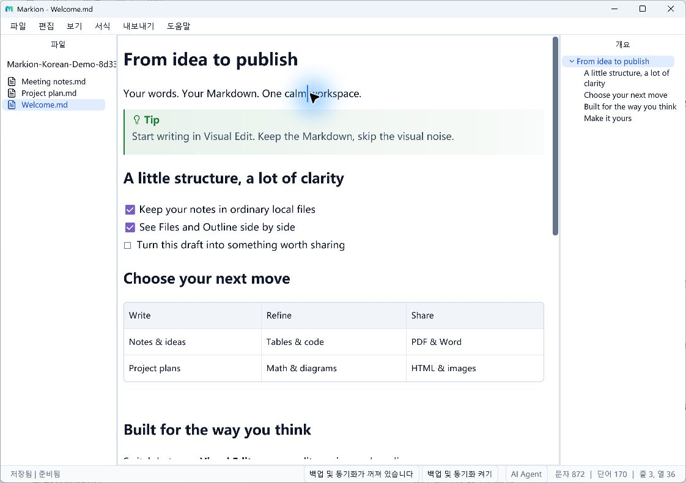
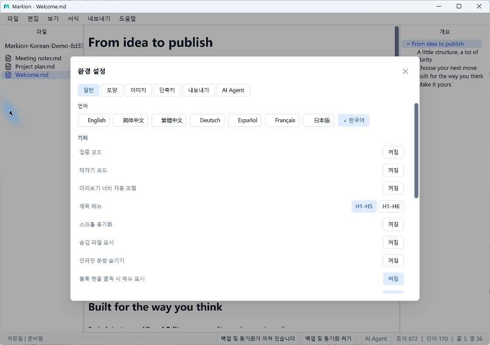

<p align="center"></p>
<h1 align="center">Markion</h1>
<p align="center"><strong>자연스럽게 쓰고, Markdown의 자유를 지키세요.</strong><br>메모부터 기술 문서와 발행할 글까지. Rust + GPUI로 만든 네이티브 편집기입니다.</p>

<p align="center"><a href="README.md">English</a> · <a href="README.zh-CN.md">简体中文</a> · <a href="README.zh-TW.md">繁體中文</a> · <a href="README.ja.md">日本語</a> · <strong>한국어</strong> · <a href="README.fr.md">Français</a> · <a href="README.de.md">Deutsch</a> · <a href="README.es.md">Español</a></p>

<p align="center">
  <a href="https://github.com/willmove/markion/releases/latest"></a>
  
  <a href="LICENSE"></a>
</p>

<p align="center"><a href="#install"><strong>다운로드</strong></a> · <a href="#new-in-v061">새로운 기능</a> · <a href="#performance">실측 성능</a> · <a href="docs/user-guide.md">사용 안내</a></p>



<p align="center"><sub>Windows 실제 화면, 한국어 UI 소스 빌드 (배포된 v0.6.0 이후 변경) · <a href="docs/images/README.md">스크린샷과 예제 작업 공간</a></sub></p>

<details>
<summary>한국어 설정 화면 보기</summary>

<p align="center"></p>

</details>

## Markion을 선택하는 이유

| ✍️ 글쓰기에 집중 | 📁 내 파일은 내 손에 | 📤 초안에서 발행까지 |
| --- | --- | --- |
| 시각 편집은 불필요한 문법 표시를 줄여 줍니다. 필요하면 소스나 분할 미리보기로 전환하세요. | 계정 없이 일반 로컬 Markdown 파일로 저장합니다. Electron이나 내장 WebView 없이 Rust + GPUI로 동작합니다. | Word를 가져오고 코드, 수식과 다이어그램을 작성한 뒤 PDF, Word, HTML 또는 이미지로 내보내세요. |

<a id="new-in-v060"></a><a id="new-in-v061"></a>

## v0.6.1의 새로운 기능

| 주요 기능 | 글쓰기가 더 편해지는 변화 |
| --- | --- |
| **완전한 한국어 UI** | 8개 UI 언어를 지원합니다. 환경설정에서 **한국어**를 선택하세요. |
| **원하는 줄·문단 간격** | **환경설정 → 모양**에서 줄 간격 75–300%, 문단 간격 0–128px을 설정하세요. |
| **백그라운드 업데이트 준비** | 5시간마다 확인하며 자동 다운로드가 기본으로 켜집니다. 확인 후에만 설치하고 저장하지 않은 편집을 보호합니다. |
| **내용을 보존하는 블록 삽입** | 간결한 삽입 메뉴와 아래에 표·구분선 추가로 기존 내용을 보존합니다. 구분선 다음에 계속 입력할 수 있습니다. |

<p align="center"></p>
<p align="center"><sub>v0.6.0</sub></p>

[릴리스 노트](docs/release-notes/release-notes-v0.6.1.md) · [프로젝트 현황과 검증 기록](docs/project-status.md)

<a id="install"></a>

## 다운로드하고 바로 시작하세요

| 플랫폼 | v0.6.1 다운로드 |
| --- | --- |
| **Windows x64** | [설치 프로그램](https://github.com/willmove/markion/releases/download/v0.6.1/markion_0.6.1_x64-setup.exe) · [포터블 ZIP](https://github.com/willmove/markion/releases/download/v0.6.1/markion_0.6.1_x64-portable.zip) |
| **macOS 11+** | [Apple Silicon](https://github.com/willmove/markion/releases/download/v0.6.1/Markion_0.6.1_aarch64.dmg) · [Intel](https://github.com/willmove/markion/releases/download/v0.6.1/Markion_0.6.1_x64.dmg) |
| **Linux x86_64** | [AppImage](https://github.com/willmove/markion/releases/download/v0.6.1/markion_0.6.1_x86_64.AppImage) · [DEB](https://github.com/willmove/markion/releases/download/v0.6.1/markion_0.6.1_amd64.deb) · [RPM](https://github.com/willmove/markion/releases/download/v0.6.1/markion_0.6.1_x86_64.rpm) |

[모든 릴리스와 검증 정보](https://github.com/willmove/markion/releases)

- **Windows:** 설치 프로그램을 실행하거나 ZIP을 풀어 주세요. 아직 Authenticode 서명이 없어 SmartScreen에서 **추가 정보 → 실행**이 필요할 수 있습니다.
- **macOS:** Markion을 응용 프로그램 폴더로 옮기세요. **v0.6.1은 ad-hoc 서명만 있으며 Apple 공증을 받지 않았습니다.** 브라우저로 받은 신뢰할 수 있는 복사본은 설치 후 다음 명령으로 격리 속성을 해제하세요:

  ```bash
  xattr -cr /Applications/Markion.app
  ```

  브라우저로 업데이트를 받을 때마다 다시 실행해야 합니다. [첫 실행 안내](docs/user-guide.md#install).
- **Linux:** AppImage에 실행 권한을 부여한 뒤(`chmod +x Markion*.AppImage`) 실행하거나 DEB/RPM을 설치하세요. FUSE가 없으면 `--appimage-extract-and-run`을 사용하세요.

Markdown 파일이나 폴더를 열면 글쓰기를 시작할 수 있습니다. 예제를 수정하기 전에는 **이미지를 포함한 examples 폴더 전체를 먼저 복사하세요**. [시작 안내와 템플릿](assets/examples/README.md).

## 하나의 문서, 네 가지 작업 방식

| 모드 | 용도 |
| --- | --- |
| **시각 편집** · 기본 | 렌더링된 Markdown에서 본문, 표, 코드와 수식을 바로 편집합니다. |
| **소스** | Markdown 문법 전체를 직접 다룹니다. |
| **분할 미리보기** | 소스와 미리보기를 나란히 표시하고 필요하면 스크롤을 동기화합니다. |
| **읽기** | 편집 기능 없이 깔끔하게 읽습니다. |

모드를 바꿔도 위치, 선택 영역과 실행 취소 기록을 유지합니다. [단축키](docs/keyboard-shortcuts.md).

| 초안에서 완성까지 | 지원 기능 |
| --- | --- |
| **기술 문서** | GFM 표, 코드 구문 강조, LaTeX 수식, Mermaid, 각주, 콜아웃과 이동 가능한 개요. |
| **기존 작업 가져오기** | 로컬 DOCX 가져오기 및 Word, Google Docs, 웹의 서식 있는 텍스트 붙여넣기. [Word 가져오기](docs/word-import.md) |
| **내보내기와 발행** | Markdown, 스타일 적용/일반 HTML, LaTeX, DOCX, PDF, PNG/JPEG 및 WeChat용 로컬 MarkNice 작업 공간. [발행 안내](docs/marknice-workspace.md) |
| **이미지와 리소스** | 붙여넣기, 끌어놓기, 복사/다운로드 및 PicGo·사용자 명령을 통한 업로드. [이미지 안내](docs/image-handling.md) |
| **나에게 맞게 설정** | **Preferences → Appearance**에서 테마, 영역별 글꼴과 서식을 조절하세요. 집중·타자기 모드와 단축키 사용자 설정도 지원합니다. |
| **필요할 때만 연결** | Git 기반 백업·동기화와 사용자 API 키 또는 로컬 모델을 사용하는 AI Agent. AI는 **기본적으로 꺼져 있습니다**. [동기화](docs/git-sync.md) · [AI](docs/ai-agent-guide.md) |

<a id="performance"></a>

## 근거를 확인할 수 있는 성능

**Windows release 빌드의 과거 실측 · 2026-11-11.** Intel Core Ultra 5 225U, RAM 약 31 GiB, 문서 크기별 부분 편집 100회. 아래 표는 크기에 따른 **모델 처리 시간**을 비교하며 UI 배치·paint와 GPU 화면 표시를 포함하지 않습니다.

| 혼합 Markdown | 첫 모델 생성 | 편집 P50 | 편집 P95 |
| --- | ---: | ---: | ---: |
| 100 KiB | 10.77 ms | **0.64 ms** | 1.21 ms |
| 300 KiB | 28.67 ms | **2.55 ms** | 3.69 ms |
| 600 KiB | 55.03 ms | **5.81 ms** | 6.86 ms |
| 1 MiB | 96.84 ms | **10.33 ms** | 11.24 ms |

별도의 1 MiB 문서에서 **시스템 키 입력 1080회**를 측정했을 때, 앱 입력 콜백 → 커서 paint는 **P50 26.63 ms / P95 33.14 ms**였습니다. 하드웨어·OS 입력 전달과 GPU 화면 표시는 제외합니다. 기존 기록이며 v0.6.1의 새 벤치마크나 경쟁 제품 순위가 아닙니다. [측정 방법, 원시 데이터와 재현](docs/performance.md).

## 시작 전에 알아 두세요

- Markdown이 문서의 원본입니다. 지원하지 않거나 바이트 경계가 불확실한 문법은 소스 편집으로 처리합니다. GFM 병합 셀과 이미지 픽셀 자르기는 지원하지 않습니다. [지원 범위와 남은 과제](docs/visual-editing-quality.md).
- 내장 PDF/DOCX는 외부 변환기가 필요 없습니다. 선택한 Pandoc이 실패하면 내장 내보내기로 전환하며 형식별 재현도는 다릅니다. MarkNice 브라우저 작업 공간은 고정 버전의 편집기 외관을 따릅니다. Word 가져오기는 현재 세션에만 적용되고 Markion에 저장되지 않으므로 **Copy MD** 또는 명시적인 Markdown 저장으로 가져와야 합니다. 브라우저 Word와 테마 적용 인쇄 PDF는 네이티브 내보내기와 다릅니다. 해당 작업 공간에는 Markdown/PDF/이미지 가져오기 및 예제 작업이 없습니다.
- Windows 설치 버전과 Linux AppImage는 Minisign으로 검증한 앱 내 업데이트 설치를 지원합니다. macOS와 DEB/RPM은 다운로드를 엽니다. 업데이트 검증과 OS 코드 서명은 별개입니다.
- **README와 UI 모두 8개 언어**: 영어, 중국어 간체/번체, 일본어, 한국어, 프랑스어, 독일어, 스페인어. 환경설정에서 **한국어**를 선택하세요.

## 빌드와 기여

Rust stable과 플랫폼별 네이티브 빌드 도구를 준비한 뒤([CI 빌드 설정](.github/workflows/release.yml)) 저장소 루트에서 실행하세요:

```powershell
cargo run
cargo test --workspace
pwsh ./scripts/check-quality.ps1
```

[사용 안내 / 使用指南](docs/user-guide.md) · [FAQ](docs/faq.md) · [문제 보고](https://github.com/willmove/markion/issues) · [릴리스 절차](docs/release-process.md) · [MIT 라이선스](LICENSE)
