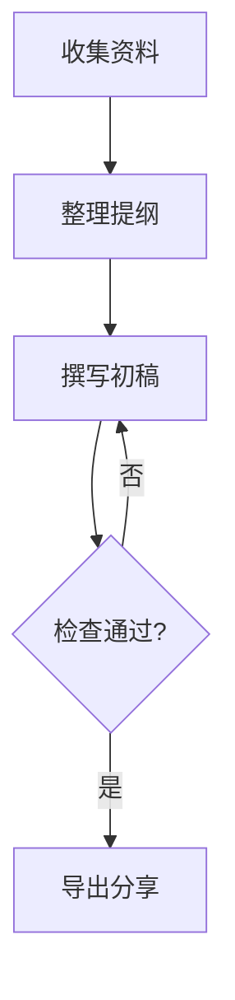

# 代码、数学公式与图表

适用于技术笔记、课程作业和方案说明。修改代码围栏、公式或图表时，可切换到源码进行精确编辑。[返回目录](README.md)

## 代码块与语言标记

围栏第一行的语言名用于语法高亮。这里的程序只作为文本展示，编辑器不会因为打开文档而执行它。

```rust
fn completion(done: usize, total: usize) -> f64 {
    if total == 0 {
        return 0.0;
    }
    done as f64 / total as f64 * 100.0
}
```

```python
tasks = ["读资料", "写初稿", "检查格式"]
for number, task in enumerate(tasks, start=1):
    print(f"{number}. {task}")
```

```json
{
  "project": "文档整理",
  "offline": true,
  "owners": ["小林", "小周"]
}
```

```text
输入：三份会议记录
处理：归纳决策和行动项
输出：一份项目摘要
```

练习：新增一个 `python` 代码块；更改语言标记，比较高亮效果。在偏好设置中试用代码字体、行号等显示选项。

## 行内公式与独立公式

行内公式适合解释变量，例如完成率 $p = d / n$，其中 $d$ 是已完成任务数，$n$ 是总任务数。

独立公式适合较长的计算：

$$
p = \frac{d}{n} \times 100\%
$$

$$
\bar{x} = \frac{1}{N}\sum_{i=1}^{N}x_i
$$

练习：把完成率公式中的变量替换为具体数字；保留公式分隔符，观察渲染是否正常。公式支持范围取决于渲染器，正式分享前请检查输出。

## Mermaid 流程图

流程图适合描述“从输入到结果”的路径。围栏语言使用 `mermaid`，节点名称保持简短。



练习：在“撰写初稿”和“检查通过”之间添加“同伴审阅”节点，检查连线；再撤销，观察图表恢复。

## 技术文档的交付检查

- [ ] 代码块语言与正文一致，没有泄露真实令牌或密码
- [ ] 公式中的变量有定义，单位一致
- [ ] 图表能在阅读或预览模式中显示
- [ ] 导出文件里的代码、公式和图表已逐项核对

继续使用[问题排查记录](18-troubleshooting.md)，把代码、日志和证据组合成一份可复用的技术记录。
