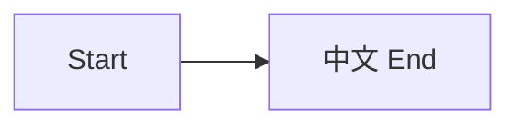

# 渲染与导航 {#qa-explicit}

[TOC]

## 重复标题

中文与 **bold**、*italic*、==highlight==、H~2~O、x^2^、&amp;、&#x1F600;、\*literal\*。

链接 [中文标题](#重复标题)、[显式 ID](#qa-explicit)、[重复第二项](#重复标题-1)。脚注[^qa]。

## 重复标题

Term
: definition 中文

行内 $E=mc^2$。

$$
\frac{a}{b}+\sqrt{x}
$$



```rust
fn main() {
    println!("QA 中文😀");
    let very_long_line = "abcdefghijklmnopqrstuvwxyz0123456789abcdefghijklmnopqrstuvwxyz0123456789abcdefghijklmnopqrstuvwxyz0123456789";
}
```

    indented code
    second line

<div><h3>HTML heading</h3><p><strong>HTML bold</strong> 与 <u>underline</u></p></div>

行内 HTML <em>italic</em><br>第二行 <unknown>保守保留</unknown>。

[^qa]: 脚注内容，包含中文。

---

最后一段，未闭合围栏位于下一行。

```text
unclosed fence payload 中文
