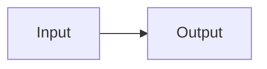

# 导出 QA

正文 中文😀 é、**粗体**、*斜体*、~~删除线~~、`inline` 与 [link](https://example.com)。

## 列表与结构

1. first
2. second
   - nested 中文

- [ ] 待办
- [x] 完成

> [!NOTE]
> 提示正文。

Term
: definition

| Name | Value |
| --- | ---: |
| 中文 | 42 |


公式 $x^2$。

$$
\frac{1}{2}
$$

```rust
fn export_qa() { println!("中文"); }
```



脚注[^one]。

[^one]: 导出脚注。
