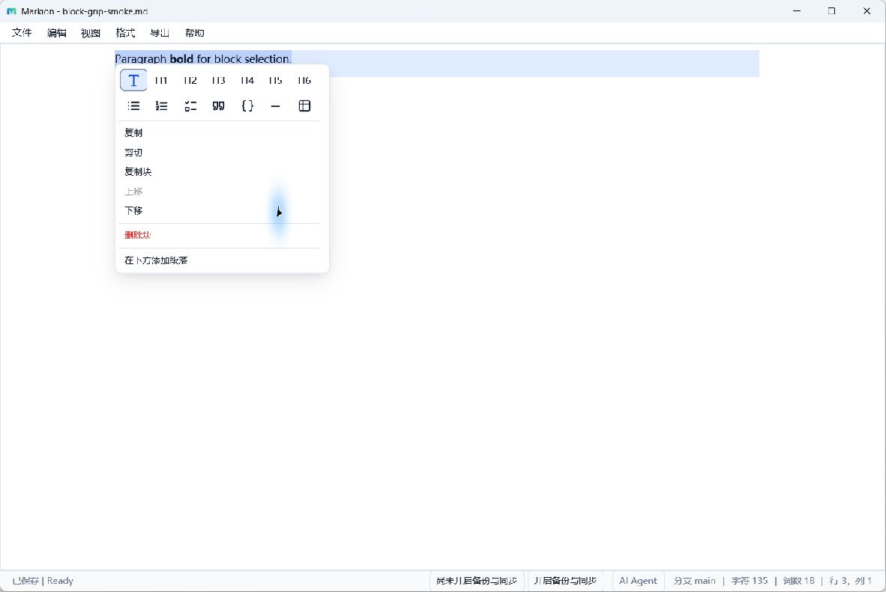
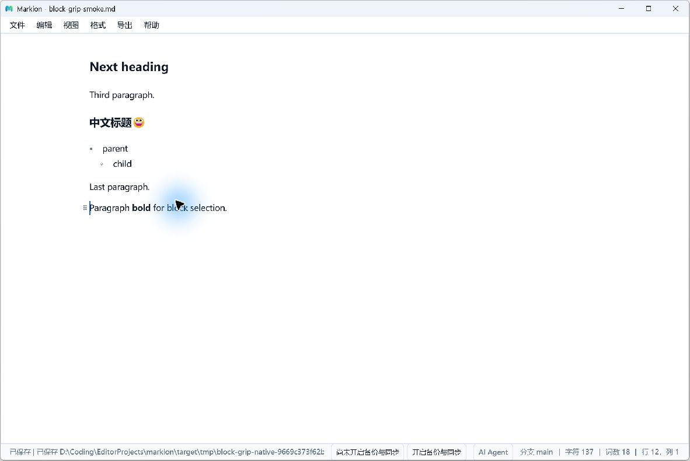

# 块首快捷菜单与选区边界验证（2026-11-16）

变更：[fix-block-handle-selection-and-menu](../../openspec/changes/archive/2026-11-17-fix-block-handle-selection-and-menu/proposal.md)。本记录覆盖 Windows 开发构建，不表示新版本已经发布；稳定规格将在变更归档时同步。

## 实现结果

- 块选择仍使用完整、半开源码范围。排除的末端不再作为下一标题、列表、引用或行内标记内的插入光标；选中块自己的结构标记仍属于其源码。真正的折叠光标、实际相交选区、空结构行和 IME 标记保留展开能力，完整包含的行内格式仍可保持渲染形态。
- 普通手柄单击完成后选择该块并弹出紧凑菜单；按下时不打开，拖动开始后框架取消待定单击，Shift-click 只扩选。事件重新验证版本、块身份和范围，不依赖旧虚拟行下标。
- 菜单提供文本、H1–H6、列表、引用、代码、分隔线和表格转换，以及复制、剪切、复制块、移动、删除和下方新增段落。操作复用现有结构剪贴板与检查事务；窄窗口键盘导航使用菜单自己的滚动句柄。
- “文件 → 首选项 → 常规 → 点击块首时显示快捷菜单”默认开启。`block_handle_menu = false` 关闭自动弹出，保留点击选块、扩选、拖动及显式右键/键盘菜单。缺失或非布尔值回退到开启，重置恢复开启。
- 选择、菜单和偏好变化不改变文档版本、撤销历史或每版本共享派生缓存。颜色和任意段落对齐不在此次菜单范围内。
- 后续已补齐重排连接处的块分隔：无末尾换行或仅有一个 LF/CRLF 时按需补足，避免段落和独立引用组合并；同一列表内项目及完整子树仍保留紧凑排列，空白行和原始内容不被重写。

## 自动回归

首轮新增十项回归：两项投影测试、一项完整源单元下方插入测试、一项配置读写/回退测试，以及六项 GPUI 桌面交互测试。拖动分隔后续修复另增三项库回归与两项桌面回归，详见下方记录。

| 检查 | 结果 |
| --- | --- |
| `cargo test --lib exclusive -- --nocapture` 对应两项测试 | 2 通过；段落/H2、中文/emoji/CRLF/H3、相邻标题、后续列表/引用、空结构、扩展/反向端点、行内标记、真实光标和 IME |
| `add_below_owns_a_blank_paragraph_after_complete_units` | 通过；段落、标题、列表子树、引用组、LF/CRLF、EOF 和过期目标 |
| `block_handle_menu_round_trips_and_defaults_safely` | 通过；开/关读写，缺失/字符串/数字/数组回退，保留其他有效设置 |
| `cargo test --bin markion block_grip -- --nocapture` | 6 通过；真实鼠标按下/释放、转换/撤销、Shift-click、多块拖动、过期命令、剪贴板 HTML/文本、剪切/插入撤销、偏好重置/持久化、明暗主题及 340×260 窄窗口键盘滚动 |
| `cargo check --tests` | 通过 |
| 根包 `cargo test`（含分隔修复） | 1575 通过、3 项既有忽略项、0 失败：库 752、桌面 818、集成 2 + 3 |
| `cargo build` | 通过；最终构建的菜单打开/关闭及选择边界已再次进行 Windows 窗口确认 |
| `cargo fmt --all -- --check`、`git diff --check`、OpenSpec strict validate | 通过 |

首次窄窗口回归暴露菜单底部命令未自动滚入可见区域。普通菜单容器不消费文档列表使用的窗口 autoscroll 请求；修复改用菜单自己的 `ScrollHandle`，六项相关测试重跑全部通过。另修正了一项既有侧栏测试中写死 Unix 路径分隔符的选择器，使其从 `PathBuf` 构造 Windows 对应路径。并行进行的 emoji 面板改动没有被回退。

## Windows OS 输入冒烟

使用 `computer-use` 的官方 Windows API、独立 APPDATA/LOCALAPPDATA、关闭自动保存/更新的专用配置和 `target/tmp/block-grip-native-*` 文档。测试没有操作用户日常配置或文档。截图表示实际窗口，GPUI 测试不冒充 OS 输入。

| 操作 | 观察与核对 |
| --- | --- |
| 段落前导手柄单击 | 弹出紧凑两行转换按钮与操作列表；第一段选中，下一 H2 不展开井号 |
| H2 转换及一次 Undo | 仅当前段落转成 H2，下一标题保持原样；一次撤销恢复块选区 |
| 偏好关闭 | 界面从“开”变成“关”，配置文件写入 `block_handle_menu = false`；第三段只被选中，后续中文 H3 的标记不展开；右键菜单仍出现 |
| 关闭后重启 | 重启隔离实例并点击第一段手柄，仍只选块、不弹框；随后通过偏好界面重新开启 |
| Cut 及一次 Undo | 保存后下一块仍以完整 `## Next heading` 开始；一次撤销并保存后与原始文件 SHA-256 一致 |
| Add Below 及一次 Undo | 光标进入两块间的空段落；保存结果严格等于原文件在下一个标题前插入一个 CRLF；一次撤销并保存后恢复原始哈希 |
| 拖动及一次 Undo | 真实拖动发生重排，过程中及释放后不弹单击菜单；一次撤销恢复原布局。验证范围是手势互斥与既有重排路径，见下方额外观察 |
| Shift+Down | 系统按键扩展块选区，未选中的后续块不被带入 |

原始与剪切/插入撤销后的测试文档 SHA-256：`B525D877E19DB741EA3BC6868226ED905CF683848E68203DA6523EF48228EE28`。

原生工具的 Windows 接口不支持按住修饰键进行鼠标单击；原生 Shift-click 未执行，其语义由 GPUI 的带 Shift 鼠标事件回归验证。明暗主题和窄窗口所有命令可达性也由 GPUI 布局/输入测试验证。macOS/Linux 的原生操作、跨应用剪贴板互操作及发布安装包不在本次验证范围。

首轮额外观察的拖动分隔问题已修复并关闭，见[拖动分隔后续修复](#拖动分隔后续修复)。首轮记录保留为历史证据，不能用首轮的手势互斥验证代替后续的源码与段落结构验证。

## 首轮集成验证记录

相关六项 GPUI 回归及根包全量回归均已通过。根包全量结果为库 749 通过/1 忽略、桌面 816 通过/2 忽略、统计集成 2 通过、Windows 帧调度集成 3 通过，总计 **1570 通过、3 忽略、0 失败**。没有执行整个 workspace 的测试或 macOS/Linux 构建，不以既有发布记录代替本次测试。

首次全量编译的新增测试字符串类型问题已修复；随后全量回归发现并修正菜单键盘滚动与既有 Windows 侧栏测试选择器问题。并行 emoji 工作流自己的回归问题在工作区后续修改中得到修正，最终完整根包测试全部通过。现存 `proc-macro-error2` future-incompatibility 提示与 MSVC 创建导出库的 linker 提示仍存在，不是本次新增失败。

首轮 `cargo build` 通过。首轮最终桌面程序与隔离验证副本的 SHA-256 均为 `E9542F9E7A6A3B0D2883E312CA76EBC52CD00FF8A8A2610C35B4F749F032AE10`；该副本已重新启动，完成实际手柄单击打开菜单、Escape 关闭菜单并保留块选区，以及后续标题标记保持隐藏的窗口确认。较早一轮原生编辑/持久化/拖动检查在补充菜单专用滚动句柄前的构建上执行，首轮键盘滚动行为由六项 GPUI 回归及完整根包回归覆盖。

## 拖动分隔后续修复

用户要求修复上述分隔问题后，新增测试先在旧连接逻辑上复现了段落和引用合并。修复让共享移动函数接收已有的块缓存，使用完整列表子树和列表层级/标记判断紧凑兄弟项，其余连接处补足空行；不通过每次移动重新解析文档来猜测容器关系。拖动、菜单与键盘移动共用这一实现，仍为一次检查事务和一次撤销。

| 回归 | 验证内容与结果 |
| --- | --- |
| `reorder_separators_keep_terminal_paragraphs_distinct` | LF/CRLF、中文/emoji、无/单个/多个终止换行、带空格或 Tab 的空白行、未终止空白行；双向移动后源码精确匹配，并重新解析为两个段落 |
| `reorder_separators_keep_tight_list_subtrees_and_quote_groups` | 无/有末尾换行、无序/有序列表（含 `)` 标记）、嵌套子项/围栏代码/引用；源字节保留且紧凑列表不变松散；独立引用组保持分隔 |
| `selected_blocks_move_without_merging_neighbor_paragraphs` | 多块移动、向前移动、LF/CRLF、精确光标、段落计数及过期目标拒绝 |
| `reorder_drag_preserves_terminal_paragraphs_and_exact_undo` | 八组 GPUI 鼠标拖动：LF/CRLF × 上/下移动 × 单/多块；拖动前版本/缓存不变，释放后段落独立、一次撤销恢复源码和块选区，旧拖动目标被拒绝 |
| `reorder_keyboard_and_menu_preserve_terminal_paragraphs` | LF/CRLF 下的键盘 Move Down、菜单 Move Up、移动后的选区、一次撤销 |

后续最终根包 `cargo test`：**1575 通过、3 项既有忽略项、0 失败**，其中库 752、桌面 818、集成 2 + 3。`cargo build`、格式/空白检查与 OpenSpec 严格校验通过。首次新增的引用子树测试把引用自身正常的 `
` 也当成列表变松散，已改为比较移动前后的段落标签数量；源码精确断言保留，最终全部回归通过。

最终 Windows 开发构建 SHA-256：`6DB88C16ACD60D5480BB41CE04DA93B2E8B9554E48071E148CFCBBEE03C7D248`。隔离配置下重放“首段拖到只有一个末尾 CRLF 的末段之后”，保存结果严格等于原文剩余部分、一个补充 CRLF 与原首段源码的连接；没有改写原内容和行结束。保存后的 SHA-256 为 `79FE3CA9798E6EF92EF27C8832EC9914D3BF780A4220DF95A7DF742A757C1C8A`。一次 Undo 并保存后，原始与恢复文件均为 `B525D877E19DB741EA3BC6868226ED905CF683848E68203DA6523EF48228EE28`。这关闭了先前记录的已知问题。

本轮 OS 输入覆盖单块向下拖动、保存与一次撤销；双向和多块组合由上述 GPUI 回归覆盖。macOS/Linux 原生拖动与安装包验证未执行。[原始核对摘要](block-reorder-separators-windows-2026-11-16.json)。

