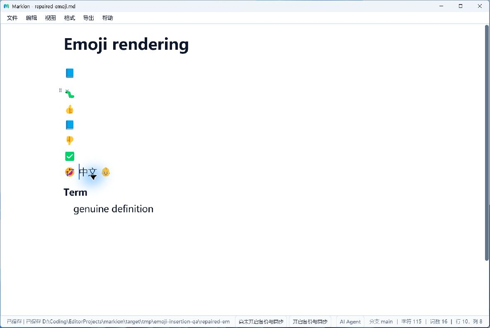
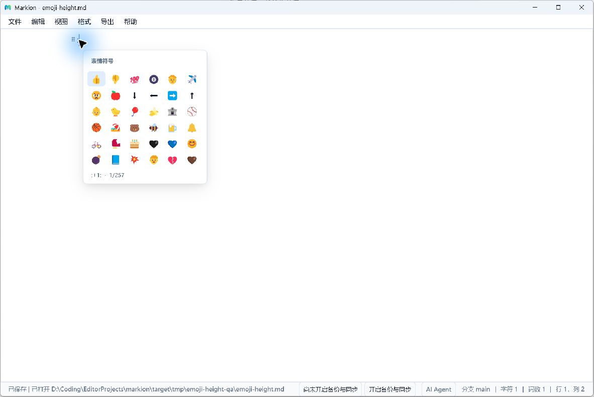

# 表情插入与块内显示验证（2026-11-16）

变更：[align-emoji-completion-palette](../../openspec/changes/archive/2026-11-17-align-emoji-completion-palette/proposal.md)。本记录对应 Windows 开发构建。

## 问题与修复

截图场景已在 Windows 程序中复现：`:book:` 后的连续 `:bug:`、`:+1:`、`:book:`、`:-1:`、`:check:` 被解析为定义列表，开头冒号被当作结构标记隐藏，因而显示成 `bug:` 等文字。原先单独插入的测试没有覆盖这个上下文。

共享 Markdown 事件解析现在对完整、已知表情短码优先保留其行内含义。只在实际定义列表冲突处重新解析，保护字节与恢复后的原始源码等长，原有缓存、UTF-8 字节范围及规范短码不变。真正的 `: definition`、代码内容、实体、智能标点及原有控制字符保留原行为。

表情目录由 32 个短码扩展到 257 个，复用现有 Markdown 库并保留应用原有别名和图案。弹框最初显示两行，随后按用户反馈扩大为六行、每行六个按钮，每屏 36 个候选；方向键逐项移动，滚轮浏览后续候选，底部显示当前位置/总数，输入短码前缀仍可筛选。

## 自动检查

| 检查 | 结果 |
| --- | --- |
| 修复前连续短码上下文回归 | 稳定失败，复现定义列表误判；日志 `target/tmp/emoji-insertion-qa/colon-lines-before.log` |
| 根包库/应用测试 | 755 + 821 通过，3 项既有忽略项，零失败；日志 `target/tmp/emoji-insertion-qa/final-root-tests.log` |
| Markdown 成员测试 | 单元、集成与文档测试共 223 通过；日志 `target/tmp/emoji-insertion-qa/markdown-tests.log` |
| 257 个候选确认后实际绘制投影 | 空块与中文/CRLF 后缀共 514 个组合通过 |
| 新增上下文回归 | 连续短码、引用、缩进、LF/CRLF、真实定义、代码有效载荷恢复、控制字符/实体/智能标点与源范围检查通过 |
| 候选浏览 | 方向键超过首屏、滚轮继续浏览、可见候选点击、精确源码与撤销、版本/派生缓存稳定性通过 |
| 构建与静态检查 | 独立桌面构建、Rust 格式、diff 空白与 OpenSpec strict validate 通过 |

## Windows 实机

使用官方 `computer-use` Windows API、独立 APPDATA/LOCALAPPDATA、关闭自动保存/更新的测试配置和 CRLF 文档，未修改用户日常配置或文档。

- 打开与截图相同的多行短码内容；确认所有完整短码均显示为图案。
- 光标留在原块内，将末尾 `:rofl` 用 Enter 确认为 `:rofl:`，新增的 🤣 与前面的 🐛、👍、📘、👎、✅ 同时保持渲染。
- 单次 Undo 恢复原始查询，Redo 恢复图案；在同一块继续输入中文并移动光标，图案保持正常。
- 切换阅读模式，显示与可视化编辑一致，下方真正的定义列表继续正常显示。
- 打开未筛选面板，观察 `1/257`；滚轮浏览到 `13/257` 后点击首屏之外的 👶，成功插入规范 `:baby:`。
- 保存后逐字节核对期望文本：所有完整短码、中文、无关内容及 CRLF 均准确保留，没有解析保护字符泄漏。
- 验证后已关闭隔离测试进程。最终构建位于 `target/tmp/emoji-insertion-qa/repaired/markion.exe`，构建日志为 `target/tmp/emoji-insertion-qa/repaired-build.log`。

补充：随后执行的普通 `cargo build` 已完成编译和链接，但无法覆盖正在运行的 `target/debug/markion.exe`（Windows error 5）。当前运行中的旧程序未更新；可直接启动上述已实机验证的独立修复版，或关闭旧程序后再次构建。日志为 `target/tmp/emoji-insertion-qa/debug-build.log`。

## 候选窗口高度更新

- 每屏从两行 12 个增加到六行 36 个，整体高度由约 140px 增至约 268px；宽度 248px 和 36×30px 按钮保持不变。筛选结果较少时仍按实际行数收缩。
- 9 项表情专项回归通过：36 个按钮的独立位置、六行布局、键盘/滚轮翻页、指针确认与撤销、过滤、输入位置锚定及窄窗口边界。日志为 `target/tmp/emoji-height-qa/final-tests.log`。
- Windows 实机确认六行均完整显示；点击最底行最右侧的 🤎 后，保存源码精确为 `:brown_heart:`，一次撤销恢复查询，滚轮可继续浏览下一组候选。
- 新构建为 `target/tmp/emoji-height-qa/markion.exe`。在没有 Markion 实例运行时已同步至 `target/debug/markion.exe` 及之前提供的独立修复版路径，并核对 SHA-256 一致；实机验证使用的就是更新后的常用调试程序。隔离测试进程已关闭。

